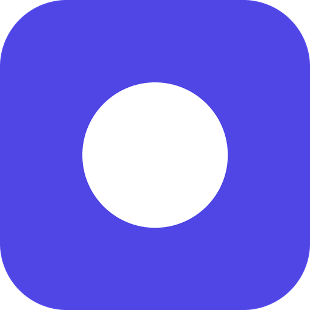
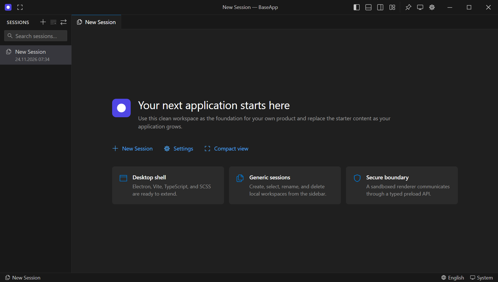
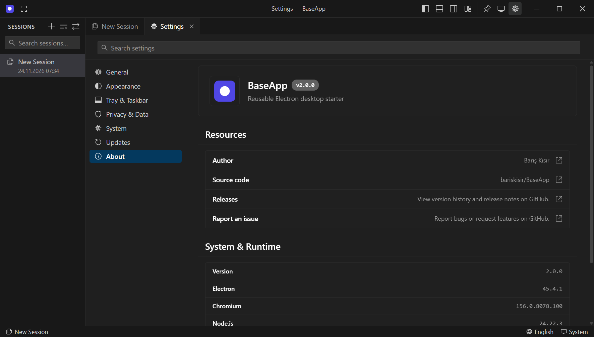

<p align="center">
  
</p>

<h1 align="center">BaseApp</h1>

<p align="center">
  A secure, reusable Electron desktop application starter built on a 4-tier layered architecture and pure-DOM workbench.
</p>

<p align="center">
  <a href="https://github.com/bariskisir/BaseApp/actions/workflows/ci.yml"></a>
  <a href="https://github.com/bariskisir/BaseApp/releases/latest"></a>
  <a href="LICENSE"></a>
</p>

<p align="center">
  
  
</p>

## Features

- **Pure TypeScript + DOM desktop shell**
  - Electron, pure TypeScript + DOM, SCSS, and Vite are wired into a 4-tier layered starter (`base`, `platform`, `workbench`, `code`) with zero React, Ant Design, Lucide, or `react-i18next` dependencies.
  - Powered by constructor dependency injection (`InstantiationService`), extensible registries (`Registry`, `ViewsRegistry`, `SettingsRegistry`), a reusable pure-DOM widget library (`src/app/base/browser/ui/`), 49 bundled SVG Codicons, native platform/CJK/monospace font stacks, and dynamic theme tokens (`ColorRegistry`, `SizeRegistry`, `ThemingRegistry`, `WorkbenchThemeService`).
  - Integrated desktop shell chrome: `35px` custom `TitlebarPart` with layout and top navigation controls, resizable Primary `SidebarPart`, Secondary `AuxiliaryBarPart`, and bottom Tertiary `TertiaryBarPart` with `Sash` resize handles, tabbed `EditorPart` (Welcome page and searchable `SettingsEditor` with TOC filtering, modified-setting indicators, hover reset, and runtime diagnostics About view), `22px` `StatusbarPart` with prominent Zoom indicator, and floating `NotificationsPart` toasts.
  - A hardened main/preload/renderer boundary keeps Node.js and Electron capabilities out of the renderer via `window.baseapp` and `ProxyChannel` over `ValidatedIpcMain`.
  - Single-instance handling restores the existing window instead of opening duplicate application instances.
  - Window size, position, maximized state, fullscreen state, Primary/Secondary/Tertiary sidebar geometry, and view locations are restored only when they still fit a connected display.

- **Flexible Primary, Secondary, and Tertiary Side Bars with movable views**
  - Views register declaratively via `ViewsRegistry` (`registerView(...)`) and are orchestrated by `ViewDescriptorService`.
  - Any movable view (such as `Sessions`) can be relocated seamlessly across the **Primary Side Bar**, **Secondary Side Bar**, and bottom **Tertiary Side Bar** via the header move-view menu, header right-click context menu, empty-bar quick buttons, or drag-and-drop without losing live DOM state.
  - Primary Side Bar position can be flipped between **Left** and **Right** (automatically placing the Secondary Side Bar on the opposite edge while keeping the Tertiary Side Bar docked beneath the center editor).
  - Sidebars start compact at their minimum resizable dimensions (`170px` width for Primary/Secondary, `120px` height for Tertiary), and `Sash` handles clamp all three sidebars collaboratively so the central editor always retains safe minimum dimensions.

- **Window zoom & keyboard shortcuts**
  - Uses exponential `1.2 ** zoomLevel` scaling (`-8` to `+8`, 20% per step) synced across `webFrame.setZoomLevel`, main-process `webContents`, browser zoom state, Settings, and a prominent Status Bar zoom entry with quick actions.
  - Built-in keyboard shortcuts: `Ctrl/Cmd+B` (Primary Side Bar), `Ctrl/Cmd+Alt+B` (Secondary Side Bar), `Ctrl/Cmd+J` (Tertiary Side Bar), `Ctrl/Cmd+,` (Settings), `Ctrl/Cmd+=` / `Ctrl/Cmd+-` / `Ctrl/Cmd+0` (Zoom In / Out / Reset), and `F11` / `Ctrl+Cmd+F` (Full Screen).

- **Generic session workspaces**
  - The movable `SessionsView` supports creating, selecting, searching, pinning, double-click/context-menu renaming (`DialogService`, `ContextMenuService`), deleting, and confirmation-guarded deleting of all local workspaces.
  - Pinned sessions remain at the top and sessions are ordered consistently by last-updated time; the last active session is restored on startup.
  - Each session provides a generic data object that downstream applications can extend with their own domain model.
  - Delete actions are disabled for the final empty session; other final-session and bulk deletions create a clean replacement.
  - Session and settings writes are serialized via `FileOperationQueue` and atomic file writes to prevent rapid operations from overwriting each other.

- **Compact mode**
  - Hides sidebars and global navigation controls for a distraction-free workspace.
  - Remains available from the titlebar alongside an inline opacity slider and exits automatically when opening Settings.

- **General settings**
  - Interface localization via `i18next` for English, Turkish, German, French, Portuguese, Chinese, Spanish, Russian, Japanese, and Korean.
  - Configurable calendar date formats (`DD.MM.YYYY`, `MM/DD/YYYY`, `YYYY-MM-DD`, or automatic locale) and 12-hour or 24-hour clocks.
  - Launch at system startup on Windows and macOS packaged builds.

- **Appearance & Window settings**
  - System, light, and dark themes resolved dynamically through `ColorRegistry` (including `widgetColors`), `SizeRegistry`, and `WorkbenchThemeService` (`--baseapp-*` CSS variables) with dark (`#1F1F1F` workbench/editor, `#181818` chrome, `#0078D4` accent) and light (`#FFFFFF` workbench/editor, `#F8F8F8` chrome, `#005FB8` accent) palettes, synchronized native window backgrounds, and `35px` `titleBarOverlay`.
  - Primary Side Bar location (`left` or `right`), Status Bar visibility, and window zoom level (`-8` to `+8`).
  - Window opacity slider, always-on-top control, and one-click window/sidebar/view layout reset.
  - Centralized accent (`#0078D4` / `#005FB8`) and session accent (`#4DAAFC` / `#005FB8`) tokens registered in `src/app/platform/theme/common/colors/` for downstream branding.

- **Tray & Taskbar settings**
  - Optional system tray icon with selectable icon presets, localized tray context menu updated live without recreating the tray icon, minimize-to-tray-on-close, start minimized, and taskbar visibility toggle with an inline accessibility notice when both are hidden.

- **Privacy & Data settings**
  - Screen-capture content protection and opt-in anonymous startup telemetry (disabled by default; uses `APPLICATION_INSIGHTS_CONNECTION_STRING` when set or falls back to `src/app/platform/product/common/productService.ts`).
  - Export and import settings JSON backups with Zod schema validation, direct access to the application data folder, and confirmation-guarded factory reset.

- **System, Diagnostics & About**
  - Configurable GPU hardware acceleration with restart prompt and one-click relaunch when modified.
  - Daily general and warning/error log files with bounded retention, configurable log levels, live log count/size summary, folder shortcut, and one-click log cleanup.
  - Clean About view with product identity banner, clickable resource link list (Author, Source Code, Releases, Report an Issue), and live System & Runtime details (Version, Electron, Chromium, Node.js, V8, OS/Arch, and License).

- **Updates**
  - **Automatic updates:** enabled by default for packaged builds and checks the latest stable GitHub Release during startup.
  - **Manual checks:** can be started from Settings and report checking, download progress, availability, errors, and release notes, mirrored in the status bar and floating update toast.
  - **Verified downloads:** Windows selects the exact x64 or arm64 NSIS installer, validates its size, and verifies its SHA-256 digest when GitHub provides one.
  - **Unattended updates:** disabled by default and available only while automatic updates are enabled. When opted in, a downloaded Windows installer runs silently and reopens the updated application.
  - **Attended installation:** when unattended updates are off, the downloaded installer waits for the user to choose **Install now**.
  - **macOS and Linux behavior:** reports the available release page instead of attempting to run a Windows installer.

- **Security defaults**
  - Context isolation, renderer sandboxing, disabled Node integration, denied permission requests, and blocked popups.
  - A typed `ProxyChannel` IPC bridge over `ValidatedIpcMain` enforcing channel prefixing (`baseapp:`), main-frame sender verification, origin allow-lists, and Zod argument validation on every privileged command.
  - Allow-listed renderer navigation and external URLs.

- **Starter-friendly engineering**
  - Central application identity and telemetry fallback configuration in `src/app/platform/product/common/productService.ts`.
  - Strict TypeScript (`strict`, `exactOptionalPropertyTypes`, `noUncheckedIndexedAccess`, `experimentalDecorators`), Zod validation, pure-DOM UI widgets, Codicon SVGs, SCSS stylesheets consuming `--baseapp-*` tokens, typed localization resources, Biome linting, Prettier formatting, co-located Vitest suites with disposable-leak tracking and V8 coverage, and automated architectural boundary tests.
  - Push/PR verification, Dependabot updates, and a separate tagged-release workflow.
  - Windows x64/arm64 NSIS, macOS x64/arm64 DMG, and Linux x64/arm64 AppImage packaging commands.

---

## Use BaseApp as a starter

Create a repository from this project or clone it, then complete this checklist before publishing your own application:

1. Update the identity and project links in [`src/app/platform/product/common/productService.ts`](src/app/platform/product/common/productService.ts).
2. Update `name`, `productName`, `appId`, author, repository, homepage, and issue links in [`package.json`](package.json).
3. Replace the SVG, PNG, and ICO files in [`build/`](build/) and replace the screenshots in [`images/`](images/).
4. Update the application name, tagline, workspace copy, and any new feature text in the shared locale resources under [`src/app/platform/localization/common/locales/`](src/app/platform/localization/common/locales/).
5. Replace the Application Insights fallback or keep telemetry disabled. A runtime `APPLICATION_INSIGHTS_CONNECTION_STRING` environment variable takes precedence over the checked-in fallback.
6. Extend `SessionData`, Zod validators, `ProxyChannel` IPC contracts, workbench services/contributions, and co-located Vitest suites together when adding domain features.
7. Contribute new movable sidebar views via `registerView(...)` in `src/app/workbench/common/views.ts`, new settings views via `registerSettingsCategory(...)`, custom theme tokens in `src/app/platform/theme/common/{colors,sizes}/` and `src/app/workbench/common/theme.ts`, and pure-DOM UI with `src/app/base/browser/ui/` and `codicons.ts`.
8. Review installer signing, macOS notarization, telemetry consent, privacy disclosures, and update behavior before distributing builds.
9. Update README badges, screenshots, release links, `LICENSE`, `SECURITY.md`, and repository settings for the new project.

Changing `APP_SLUG` or `APP_NAME` also changes the application-data directory used by new builds. Existing local data is not migrated automatically across renamed applications.

## Requirements

- Node.js 24 or newer
- npm 11 or newer
- Windows, macOS, or Linux for development
- The target operating system for native installer production; signing and notarization require platform-specific credentials

## Development

```bash
git clone https://github.com/bariskisir/BaseApp.git
cd BaseApp
npm ci
npm run dev
```

| Command | Purpose |
| --- | --- |
| `npm run dev` | Start Vite and Electron with renderer hot reload |
| `npm start` | Build and launch the production Electron bundles locally |
| `npm run verify` | Run lint, tests, format checking, type checking, and a production build |
| `npm run test` | Run the co-located Vitest suite once |
| `npm run test:coverage` | Run the Vitest suite with V8 code coverage reporting |
| `npm run test:watch` | Run Vitest in watch mode |
| `npm run lint` | Run Biome linting |
| `npm run format` | Format source, test, and config files with Prettier |
| `npm run format:check` | Verify Prettier formatting |
| `npm run typecheck` | Type-check `tsconfig.node.json`, `tsconfig.web.json`, and `tsconfig.test.json` |
| `npm run build` | Type-check and build renderer, main, and preload bundles |

## Architecture

BaseApp follows a strict 4-tier layered architecture with explicit runtime boundaries (`common/`, `node/`, `browser/`, `electron-main/`, `electron-browser/`) and co-located test suites (`test/`):

```text
src/app/
├── base/         Zero-domain utilities (lifecycle + DisposableTracker, events, async, color, formatters,
│   │             number, platform, atomic file I/O, FileOperationQueue)
│   ├── browser/  Pure-DOM helpers ($), browser zoom/fullscreen state, 49 inline SVG Codicons, dynamic
│   │             stylesheets, and reusable UI widgets (Widget, Button, InputBox, Checkbox, SelectBox,
│   │             SegmentedControl, Slider, Sash, ActionBar, ContextMenu, Dialog, ProgressBar, Tooltip)
│   ├── parts/    IPC transport (ProxyChannel, ValidatedIpcMain, ElectronIpcServer/Client) & sandbox preload
│   └── test/     Disposable leak-detection helpers, fake-DOM harness, and base-layer unit tests
├── platform/     Reusable desktop services, registries & co-located tests (DI InstantiationService +
│                 TestInstantiationService, Registry, ThemeService, ColorRegistry + widgetColors,
│                 SizeRegistry, Configuration, Sessions, State, Window & Zoom, NativeHost + RuntimeInfo,
│                 Tray, Logger, Update, Telemetry, Localization, Product, Environment, Lifecycle,
│                 Commands, Security)
├── workbench/    Pure TypeScript + DOM renderer workbench & co-located tests: DI services
│                 (WorkbenchThemeService, WorkbenchLayoutService, ViewDescriptorService,
│                 SessionsWorkbenchService, DialogService, ContextMenuService, NotificationService,
│                 CommandService), registries (ViewsRegistry, SettingsRegistry,
│                 WorkbenchContributionsRegistry), shell parts (TitlebarPart, Primary SidebarPart,
│                 Secondary AuxiliaryBarPart, Tertiary TertiaryBarPart, EditorPart with Welcome &
│                 Settings views, StatusbarPart, NotificationsPart), feature contributions, and bootstrap
├── code/         Thin application entrypoints for electron-main (CodeMain, CodeApplication) and
│                 electron-browser (index.html, entry.ts) with co-located tests
└── test/         Cross-cutting architectural boundary and repository hygiene tests
```

- **Dependency injection & registries:** Services declare decorator tokens with `createDecorator<IService>(id)`, bind via `ServiceCollection` / `SyncDescriptor` / `registerSingleton`, and resolve through `InstantiationService`. Extensible registries (`Registry`, `ColorRegistry`, `SizeRegistry`, `ThemingRegistry`, `CommandsRegistry`, `ViewsRegistry`, `SettingsRegistry`, `WorkbenchContributionsRegistry`) keep features decoupled.
- **IPC & sandboxing:** The renderer cannot access Node.js, Electron, or the filesystem directly. `preload.ts` exposes a narrow `window.baseapp` bridge limited to `baseapp:` channels and `webFrame` zoom controls, while `ElectronIpcServer` and `ProxyChannel` route typed calls and events through `ValidatedIpcMain` with Zod validation.
- **Layer enforcement:** `src/app/test/architecture/layerBoundaries.test.ts` automatically verifies vertical layer imports (`base` -> `platform` -> `workbench` -> `code`), runtime environment isolation, `ValidatedIpcMain` exclusivity, zero React/AntD/Lucide/`react-i18next` imports or dependencies, zero `Settings2` references, and zero-comment source hygiene.
- **Data isolation:** Durable settings, sessions, telemetry identity, logs, and window state are stored below the operating system's application-data directory (`Data/` and `Logs/`), while Chromium runtime files are isolated under `Runtime/`.

## Packaging

| Command | Output |
| --- | --- |
| `npm run package` | Unpacked application directory for the current platform |
| `npm run package:win` | Windows x64 and arm64 NSIS installers |
| `npm run package:mac` | macOS x64 and arm64 DMG images |
| `npm run package:linux` | Linux x64 and arm64 AppImages |

Linux architecture-specific variants are also available as `package:linux:x64` and `package:linux:arm64`.

Tagged `v*` pushes run the release workflow for Windows and Linux artifacts. Ensure the tag exactly matches the version in `package.json`. The included installers are unsigned starter outputs; production applications should configure code signing and macOS notarization.

## Security

The starter uses sandboxed renderers, context isolation, disabled Node integration, restrictive navigation and popup policies, a Content Security Policy, main-frame IPC validation via `ValidatedIpcMain`, Zod payload validation on `ProxyChannel` handlers, and allow-listed external URLs. See [SECURITY.md](SECURITY.md) for private vulnerability reporting guidance.

## License

[MIT](LICENSE)
